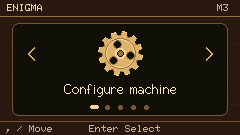
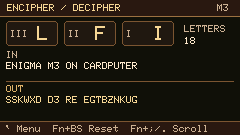

<h1 align="center">Enigma M3 for M5Stack Cardputer</h1>

<p align="center"><strong>A hands-on simulator of the three-rotor Enigma M3.</strong></p>

<p align="center">
  <a href="#try-a-message">Try a message</a> ·
  <a href="#install-firmware">Install firmware</a> ·
  <a href="#build-from-source">Build from source</a>
</p>

| Main menu | Live rotor and message view |
| :---: | :---: |
|  |  |

The firmware runs directly on the Cardputer and uses its keyboard and 240 × 135
display. A three-gear intro opens into a carousel inspired by the Enigma’s wooden
case and brass hardware. The simulator works offline.

## Features

- **Enigma M3 mechanics** with three selectable rotors from I–VIII, wide reflectors
  B and C, configurable ring settings and starting positions, and up to ten
  plugboard pairs.
- **Historical stepping** with rotor turnover, double-stepping, and the two
  notches on naval rotors VI–VIII.
- **Live encryption and decryption** with visible rotor positions. Backspace
  restores the exact rotor state before the last character. Settings and messages
  stay in memory until reboot.
- **USB JSON interface** for scripted cipher sessions, diagnostics, and hardware
  tests. Serial commands have their own cipher state.

## Try a message

Select **Encrypt / decrypt** with the default settings. The left-to-right rotors
are **I, II, III**, the reflector is **B**, the rings and starting positions are
**AAA**, and the plugboard is empty.

```text
Input           AAAAA
Output          BDZGO
Rotor windows   AAF
```

Press **Backspace** to see the output return to `BDZG` and the windows to `AAE`.
To decrypt, reset the machine to the same starting positions and type the
ciphertext. Only letters advance the rotors. Typed spaces and supported punctuation
pass through unchanged.

| Key | Action |
| --- | --- |
| `,` or `/` | Move left or right in the main menu. The `Fn` arrow shortcuts also work. |
| **Enter** | Select a menu card or save a setting. Choose **Apply & type** to apply configuration changes. |
| **Esc** (top-left backtick key) | Go back. |
| **Backspace** | Delete the last character and restore its previous rotor state. |
| **Fn + Backspace** | Clear the message and return to the configured starting positions. |
| **Fn +** `;` or **Fn +** `.` | Scroll through the message. |

## Install firmware

**Hardware tested:** M5Stack Cardputer-ADV with 8 MiB flash. The original
Cardputer uses the same library’s board support and has not been tested here.

Build the merged image using the commands below, then back up the existing
firmware and settings. Use a compatible ESP32-S3 USB flasher to write
`enigma-cardputer-merged.bin` at **`0x0`**. The separate `firmware.bin` is the
application image at `0x10000` and requires matching boot files.
See the [USB installation guide](docs/flashing.md) for the full procedure.
The [web installer guide](docs/web-installer.md) covers the local browser preview
and the manual GitHub Pages workflow.

## Build from source

The documented build environment is Linux with [uv](https://docs.astral.sh/uv/),
Python 3.12, GCC/G++, CMake, Make, and Git. From the repository root, run:

```bash
bash tools/setup.sh
bash tools/build.sh
source tools/env.sh
python tools/package.py
```

The build uses PlatformIO, Arduino ESP32, and the official M5Cardputer library.
The scripts keep Python dependencies and toolchains inside the checkout.
Packaging puts the merged image and its SHA-256 checksum in `releases/0.1.0/`.

Run `bash tools/test_native.sh` for desktop tests, historical vectors, and
comparisons against Py-Enigma. The hardware tools use a locally configured device
identity, and guarded flashing requires a verified backup. See the [test guide](docs/testing.md) and
[serial protocol](docs/serial_protocol.md) for details.

## Project resources

- [Firmware architecture](docs/architecture.md)
- [Changelog](CHANGELOG.md)
- [Third-party credits and notices](THIRD_PARTY_NOTICES.md)
- [MIT license](LICENSE)
